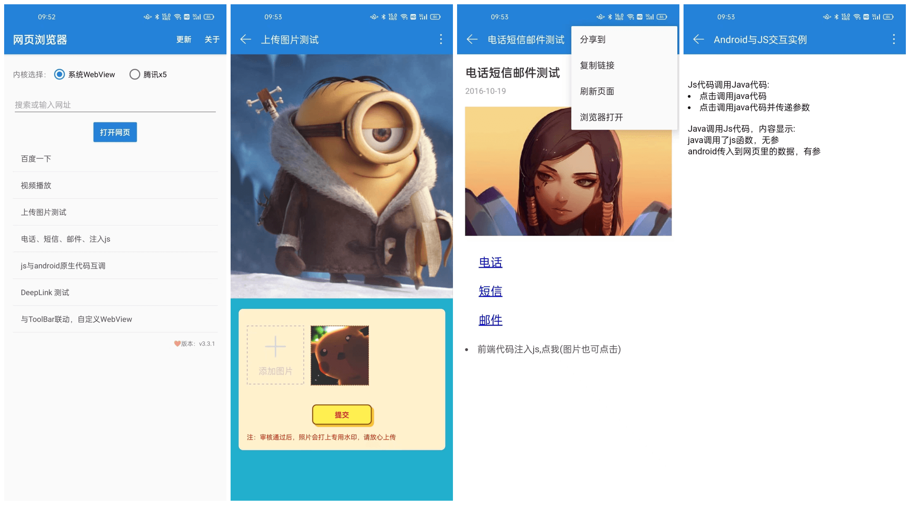

# ByWebView

简体中文 | [English](README_EN.md)

[![JitPack][5]][6] [![API][7]][8] [![download][1]][2] <!--[![version][3]][4] -->

<!--  
-->

**ByWebView is an Android WebView wrapper** with a loading progress bar, page callbacks, image selection and full-screen video support. 它面向 Android View 系统，提供 WebView 页面加载、进度条、图片选择、全屏视频和 JavaScript 交互等功能。

## 版本与更新状态 / Status

最新正式 Release 为 [1.2.2](https://github.com/youlookwhat/ByWebView/releases/tag/1.2.2)（2023-01-28）；主分支在 2026-05-12 有后续更新，**这些更新不自动包含在 1.2.2 中**。请在 [Releases](https://github.com/youlookwhat/ByWebView/releases) 查看已发布版本，并在 [Issues](https://github.com/youlookwhat/ByWebView/issues) 反馈问题。本次文档更新未验证 JitPack 依赖解析或 Android 编译。

## 使用 AI 接入

可将下方提示词复制给你的 AI 编程助手，按项目需要修改。请 AI 显式读取 [AGENTS.md](AGENTS.md)：其他项目中的助手不一定会自动加载本仓库的文件。

```text
请使用 https://github.com/youlookwhat/ByWebView 为当前 Android View 项目接入网页页面。请先阅读仓库的 README 和 AGENTS.md，确认使用的 Release 版本，结合项目的 Gradle 配置和页面生命周期完成接入；处理网页加载错误、返回导航和证书错误。按实际需求决定是否启用 JavaScript、图片选择或全屏视频，检查 URL 和 WebView 安全设置，并编译及验证；无法验证的部分请说明。
```

英文安装、完整 Activity 示例和安全注意事项见 [English README](README_EN.md)。ByWebView 是 Android View 封装，不是 Compose 原生组件；项目是否合适需结合自身需求评估。

## Features

 - 基本配置使用(宽度自适应、返回网页上一层、显示网页标题等)
 - 唤起三方应用(拨打电话、发送短信、发送邮件等)
 - 上传图片(版本兼容)
 - 错误页面处理
 - 全屏播放网络视频
 - **与Js交互实例**
 - 优雅的进度条显示控件

**Demo示例：**

 - DeepLink的基本使用
 - 被作为第三方浏览器打开
 - 与ToolBar联动，自定义WebView
 - **腾讯x5使用示例**

## Document

 - [Android 关于WebView全方面的使用（项目应用篇）](http://www.jianshu.com/p/163d39e562f0)
 - [Android DeepLink介绍与使用](https://juejin.cn/post/6844903954149539848)
 - [Android 应用被作为第三方浏览器打开](https://www.jianshu.com/p/272bfb6c0779)
 - [Android WebView与JS交互实例](https://www.jianshu.com/p/97f52819a19d)
 - [一款Android WebView进度条显示控件，使其加载进度平滑过渡](https://github.com/youlookwhat/WebProgress)

## Screenshots
 
 

## Download
 - [Demo示例下载][2]

## 引用
1. 在项目实际管理依赖仓库的位置加入 JitPack；保留 `google()` 和 `mavenCentral()`。现代 Gradle 项目一般在 `settings.gradle` 的 `dependencyResolutionManagement.repositories` 中配置，旧项目可在根目录 `build.gradle` 的 `allprojects.repositories` 中配置。

```groovy
maven { url 'https://jitpack.io' }
```

Kotlin DSL 使用 `maven { url = uri("https://jitpack.io") }`。

2. 在应用模块添加依赖：

```groovy
dependencies {
    implementation 'com.github.youlookwhat:ByWebView:1.2.2'
    implementation 'com.google.android.material:material:1.0.0'
}
```

Kotlin DSL 使用 `implementation("com.github.youlookwhat:ByWebView:1.2.2")` 和 `implementation("com.google.android.material:material:1.0.0")`。Material 在库中声明为 `compileOnly`；如果应用已有该依赖，请使用与项目兼容的版本。库声明 `minSdk` 14，实际最低版本还取决于项目依赖。

**版本注意**：1.2.2 使用的旧版构建配置和 API 可能不兼容较新的 Android/Gradle 构建环境；主分支包含尚未发布的后续修改，接入时请实际编译确认，不能假设它们已包含在 1.2.2 中。

## Use
```java
byWebView = ByWebView
        .with(this)
        .setWebParent(container, new LinearLayout.LayoutParams(-1, -1))
        .setOnByWebClientCallback(new OnByWebClientCallback() {
            @Override
            public boolean onReceivedSslError(WebView view, SslErrorHandler handler, SslError error) {
                handler.cancel();
                return true; // 已处理，避免使用库默认的“继续访问”弹窗
            }
        })
        .get();
byWebView.getWebView().getSettings().setJavaScriptEnabled(false); // 不需要 JS 时关闭
if (Build.VERSION.SDK_INT >= Build.VERSION_CODES.LOLLIPOP) {
    byWebView.getWebView().getSettings().setMixedContentMode(WebSettings.MIXED_CONTENT_NEVER_ALLOW);
}
byWebView.loadUrl("https://example.com");
```

上面是 Activity 中的片段，`container` 为已有的 `LinearLayout`；完整导入、布局及生命周期示例见 [英文快速开始](README_EN.md#quick-start)。只加载可信的 HTTPS 地址，结合业务限制页面跳转；如需 JavaScript 或图片选择，先评估页面来源及权限。

### 与Js交互
> 默认会启用 JavaScript 并允许混合内容；`addJavascriptInterface` 会向网页暴露原生对象。仅对受信任内容启用 JS/桥接，校验导航，并不要让不可信页面访问敏感方法。库的 `quickCallJs` 未对普通字符串参数进行完整 JS 转义，不要直接传入不可信输入。证书错误默认会提示用户继续，应如上示例覆盖回调并取消。

 - 调用Js方法：

```java
// 无参数调用
byWebView.getLoadJsHolder().quickCallJs("javacalljs");
// 传递参数调用
byWebView.getLoadJsHolder().quickCallJs("javacalljswithargs", "android传入到网页里的数据，有参");
```
 - Js调用Java方法：

```java
// 仅供可信页面使用。MyJavascriptInterface 暴露给网页的方法需标注 @JavascriptInterface。
// 在上面的安全配置中按需增加：
// .addJavascriptInterface("injectedObject", new MyJavascriptInterface(this))
// 同时将 JavaScript 设为启用，并先限制页面来源和导航。
// 网页可调用：window.injectedObject.startFunction()
```

### 生命周期处理
```java
@Override
protected void onPause() {
    super.onPause();
    byWebView.onPause();
}

@Override
protected void onResume() {
    super.onResume();
    byWebView.onResume();
}

@Override
protected void onDestroy() {
    byWebView.onDestroy();
    super.onDestroy();
}
```

### 返回操作
```java
@Override
public boolean onKeyDown(int keyCode, KeyEvent event) {
    if (byWebView.handleKeyEvent(keyCode, event)) {
        return true;
    } else {
        return super.onKeyDown(keyCode, event);
    }
}
```

### 上传图片之后的回调
```java
@Override
protected void onActivityResult(int requestCode, int resultCode, Intent intent) {
    super.onActivityResult(requestCode, resultCode, intent);
    byWebView.handleFileChooser(requestCode, resultCode, intent);
}
```

### 监听 标题、进度条、WebViewClient
以下示例展示回调配置；请在加载 URL 前按前面的安全示例配置 WebSettings，并按实际需求限制网页跳转。
```java
byWebView = ByWebView
        .with(this)
        .setWebParent(container, new LinearLayout.LayoutParams(-1, -1))
        .useWebProgress(ContextCompat.getColor(this, R.color.colorRed))
        .setOnTitleProgressCallback(onTitleProgressCallback)
        .setOnByWebClientCallback(onByWebClientCallback)
        .get();
// 配置 WebSettings 和 URL 策略后，再调用 byWebView.loadUrl(mUrl)。
```
```java
private OnTitleProgressCallback onTitleProgressCallback = new OnTitleProgressCallback() {
    @Override
    public void onReceivedTitle(String title) {
        Log.e("---title", title);
    }

    @Override
    public void onProgressChanged(int newProgress) {
        // 返回的进度
    }

    @Override
    public boolean onHandleScreenOrientation(boolean isShow) {
        // 返回true，视频全屏时，横竖屏自己处理
        return false;
    }
};

private OnByWebClientCallback onByWebClientCallback = new OnByWebClientCallback() {

    @Override
    public void onPageStarted(WebView view, String url, Bitmap favicon) {
        
    }

    @Override
    public boolean onReceivedSslError(WebView view, SslErrorHandler handler, SslError error) {
        handler.cancel();
        return true; // 已处理，不显示允许继续访问的默认弹窗
    }

    @Override
    public void onPageFinished(WebView view, String url) {
        // 网页加载完成后的回调
    }

};
```

### 自定义错误页面

在已有 Builder 上配置，再结合上面的回调和安全设置创建：
```java
builder.setErrorLayout(R.layout.by_load_url_error, "无法打开网页");
```

### Builder 配置示例

`builder` 应在配置完 WebSettings 和 URL 策略前使用 `get()`，不要直接加载不可信 URL。JS 桥接仅在需要时对可信页面启用。
```java
byWebView = ByWebView
        .with(this)
        .useWebProgress(true) // 是否使用进度条，默认true，如使用可不用配置
        .setWebParent(container, new LinearLayout.LayoutParams(-1, -1)) // 设置WebView父容器
        .useWebProgress("#ffb6cf", "#ff0000", 3)// 进度条渐变色(开始颜色，结束颜色，高度)
        .setOnTitleProgressCallback(onTitleProgressCallback)// title 和 progress 监听
        .setOnByWebClientCallback(onByWebClientCallback)    // WebViewClient监听
        .setErrorLayout(R.layout.by_load_url_error, "无法打开网页") // 设置错误页面及标题
        .get();
// 配置 WebSettings 和 URL 策略后，再调用 byWebView.loadUrl(mUrl)。
```


 
## Tip
 - 混淆时应加上（通过JS向网页传值，如不加有时候会传值失败）:

   ```java
   -keepattributes *Annotation*
   -keepattributes *JavascriptInterface*
   -keepclassmembers class * {
      @android.webkit.JavascriptInterface <methods>;
   }
	```   

## Thanks
 - [AgentWeb](https://github.com/Justson/AgentWeb)

## Other
 - [WebView的使用及实战](http://www.jianshu.com/p/dbf9b7c04be5)
 - [WebView性能、体验分析与优化](https://tech.meituan.com/WebViewPerf.html)
 - [Android WebView开发问题及优化汇总](http://www.cnblogs.com/spring87/p/4532687.html)
 - [https://developer.android.com/reference/android/webkit/WebSettings.html](https://developer.android.com/reference/android/webkit/WebSettings.html)
   
[1]:https://img.shields.io/badge/download-apk-blue.svg?style=flat
[2]:https://github.com/youlookwhat/download/raw/main/ByWebView.apk

[3]:https://img.shields.io/badge/version-2.7.2-brightgreen.svg?style=flat
[4]:https://github.com/youlookwhat/download/raw/main/ByWebView.apk

[5]:https://jitpack.io/v/youlookwhat/ByWebView.svg
[6]:https://jitpack.io/#youlookwhat/ByWebView

[7]:https://img.shields.io/badge/API-14%2B-red.svg?style=flat
[8]:https://android-arsenal.com/api?level=14